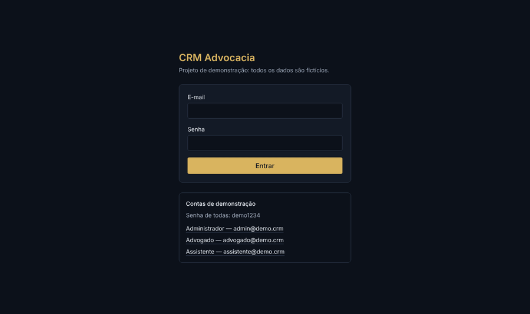
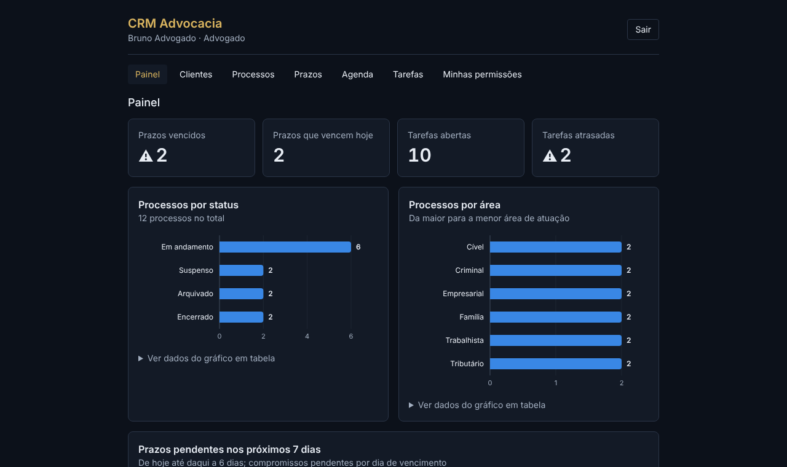
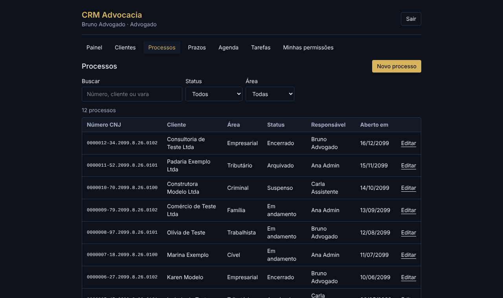
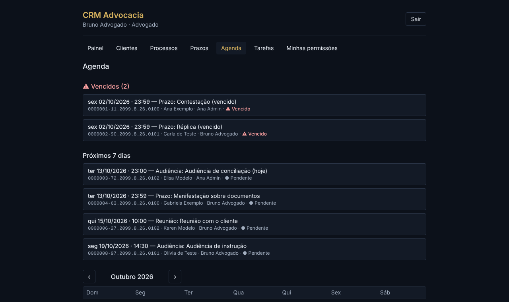
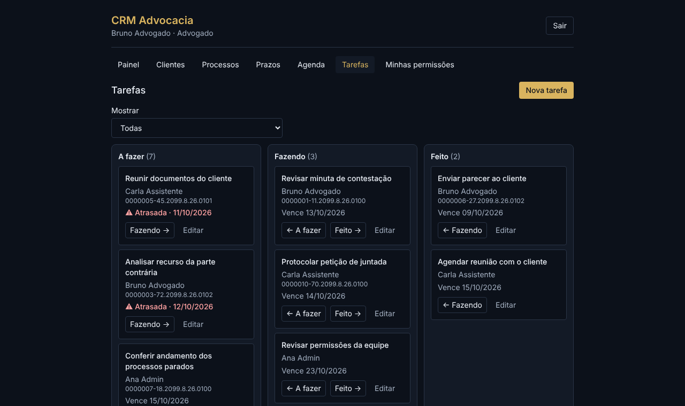

# CRM Advocacia (projeto de demonstração)

CRM para escritório de advocacia: clientes, processos, prazos em dias úteis, tarefas e auditoria.

> **Aviso:** projeto de portfólio. Todos os dados são **fictícios** (nomes, e-mails, números de processo
> com ano 2099). Não representa nenhum escritório real e não deve receber dados reais.

**Status:** v1.0 — base do sistema (monorepo, Docker Compose, schema, seed,
autenticação, perfis admin / advogado / assistente, auditoria) **clientes** (CRUD, busca, filtro e paginação no servidor) e **processos** com número no formato CNJ, validado pelo dígito verificador (módulo 97, Res. CNJ 65/2008), além de **prazos em dias úteis com feriados**, agenda, **tarefas** (quadro A fazer / Fazendo / Feito) e um **painel** com indicadores. Tudo sobe com um comando (`docker compose up --build`) e é verificado por testes de ponta a ponta com checagem de acessibilidade.

**Demo ao vivo:** https://crm-advocacia.brenojf19.workers.dev — entre com `advogado@demo.crm` / `demo1234`
(também `admin@demo.crm` e `assistente@demo.crm`). Os dados são fictícios e **são recriados todo dia às 05:00 (Brasília)**.



| Painel                         | Processos                            |
| ------------------------------ | ------------------------------------ |
|  |  |
| **Agenda**                     | **Tarefas**                          |
|  |      |

## Stack

React 19 + Vite + Tailwind · Hono · Drizzle ORM · PostgreSQL 16 · Zod · Vitest · Playwright + axe-core · Docker Compose (nginx) · GitHub Actions.
Produção: Cloudflare Workers + Hyperdrive + Neon (plano gratuito).

## Como rodar (Windows/PowerShell ou qualquer shell)

**Opção 1 — tudo em Docker (mais simples).** Só precisa do Docker Desktop:

```
docker compose up --build
```

Abra http://localhost:8080. O banco, a API e o site sobem juntos; as migrações rodam sozinhas e os dados
fictícios são criados **só se o banco estiver vazio** (reiniciar não apaga o que você cadastrou). Para
recomeçar do zero: `docker compose down -v`. O site (nginx) é o único serviço exposto e encaminha `/api`
para a API, na rede interna do Compose (mesma origem, sem CORS).

**Opção 2 — desenvolvimento** (API e web no seu computador, só o banco em Docker):

```
npm install
copy .env.example .env
docker compose up -d db
npm run db:migrate -w @crm/api
npm run seed -w @crm/api
npm run dev
```

Abra http://localhost:5173. Contas de demonstração (senha `demo1234`): `admin@demo.crm`,
`advogado@demo.crm`, `assistente@demo.crm`.

> No Compose a API roda com `NODE_ENV=production`, em que o cookie de sessão é `Secure` (só HTTPS).
> Como o acesso local é `http://localhost`, o Compose define `COOKIE_SEGURO=false`. Em um servidor com
> HTTPS, remova essa variável.

## Testes

```
npm test                 # unitários (permissões, hash de senha, regras de domínio, gráficos)
npm run test:integration # API contra Postgres (usa um banco com "test" no nome)
npm run e2e              # navegador de verdade: API + web + banco, com axe (acessibilidade)
```

Os testes de integração e o e2e apagam dados: por segurança só rodam em banco cujo nome contém `test`
(ou `e2e`). Na primeira vez do e2e, instale o navegador: `npx playwright install chromium`.

O e2e cobre: o fluxo principal (cliente → processo com número CNJ válido → prazo com vencimento
calculado, pulando fim de semana e feriado → tarefa refletida no painel), o que cada perfil enxerga
(inclusive "sem botão de excluir na tela **e** a API responde 403"), o painel básico sem dados de
processos, login/logout e **axe-core (WCAG 2.1 A/AA) em todas as telas de cada perfil**, em
formulários abertos, com as tabelas dos gráficos expandidas e em 375 px de largura. Um teste de
controle garante que o axe realmente acusa problemas (imagem sem texto alternativo, contraste ruim).

## Regras de prazos (regras do projeto fictício — não é consultoria jurídica)

- A contagem é em **dias úteis**: o dia da intimação **não conta**; o dia 1 é o primeiro dia útil seguinte.
- Sábados, domingos e **feriados cadastrados** não contam. Como a contagem só avança por dias úteis, o vencimento cai sempre num dia útil (a "prorrogação" é consequência).
- Prazo calculado vence às **23:59 (Brasília)**; audiências e reuniões têm data e hora informadas (fuso fixo UTC−3).
- Feriados nacionais (fixos + Sexta-feira Santa, via algoritmo da Páscoa) são semeados; estaduais, municipais e pontos facultativos o admin cadastra.
- Se o ano da contagem **não tem nenhum feriado cadastrado**, a API recusa gravar (422) e a tela avisa: melhor não gravar do que gravar um prazo possivelmente errado.
- Prazo "vencido" = pendente com vencimento já passado (relógio do servidor). Marcar cumprido/perdido é só admin e advogado.
- Assistente só cria/edita prazos de processos em que atua (é o responsável).
- Mudar a lista de feriados não recalcula prazos já gravados; eles são recalculados ao serem editados.

## Tarefas e painel

- Tarefa: título, responsável, vencimento opcional (data, calendário de Brasília) e processo opcional. Atrasada = não concluída e com data anterior a hoje; "vence hoje" ainda está no prazo.
- Admin e advogado atribuem tarefas a qualquer pessoa ativa e mexem em qualquer tarefa; o assistente só cria, edita e move as **próprias**. Toda alteração entra na auditoria; não há exclusão no MVP.
- O painel (`GET /api/dashboard`) tem dois níveis: o **completo** (admin e advogado) inclui processos por status e por área; o **básico** (assistente) traz só prazos e tarefas — a seção de processos **não é enviada** pela API (testado), não apenas escondida na tela.
- Gráficos: barras horizontais, colunas e barras empilhadas, todos em SVG próprio, com paleta validada (contraste e daltonismo) contra o fundo escuro, ponta arredondada de 4px, tooltip por mouse **e** teclado, legenda quando há duas séries, e uma tabela equivalente em cada gráfico ("Ver dados do gráfico em tabela").

## Deploy

Um único Worker serve a API e o site; o banco é Postgres no Neon via Hyperdrive; um Cron Trigger recria os
dados fictícios todo dia. Passo a passo em [docs/deploy.md](docs/deploy.md); decisões em
[ADR 0002](docs/adr/0002-deploy-cloudflare-neon.md). Local no estilo Workers: `npm run cf:dev`.

**Qualidade medida** (Lighthouse na tela de login, build de produção): desempenho 99, acessibilidade 100,
boas práticas 96, SEO 91. O axe-core roda no CI em todas as telas, nos 3 perfis, e não pode ter violações.

## Decisões de segurança

- Senha: PBKDF2-SHA256 via Web Crypto, roda igual em Node e Workers ([ADR 0001](docs/adr/0001-hash-de-senha.md)). Na demo gratuita usa 10.000 iterações por limite de CPU ([ADR 0002](docs/adr/0002-deploy-cloudflare-neon.md)); o padrão do código é 600.000.
- Sessão no banco; o cookie guarda um token e o banco só o hash dele (`HttpOnly`, `SameSite=Lax`, `Secure` em produção).
- Bloqueio de login: 5 falhas em 15 min por e-mail (429 + `Retry-After`); mensagem de erro genérica.
- CSRF: cabeçalho `X-Requested-With` obrigatório em requisições que alteram dados.
- Autorização num único ponto (`exigir(acao)`), com matriz `perfil × ação` testada.
- Auditoria gravada na mesma transação da alteração.

## Uso de IA

Desenvolvido com assistência de IA (Claude); as decisões, a revisão e os testes são do autor.
Usei a IA para gerar código e testes em semanas, mas cada semana só foi adiante com CI verde; ela me ajudou a
achar um bug real (colisão de chave de cache no React Query) pelos testes e2e e a medir limites do Workers
antes de decidir. Os limites da demo (hash com menos iterações, sem upload de documentos) estão documentados.
